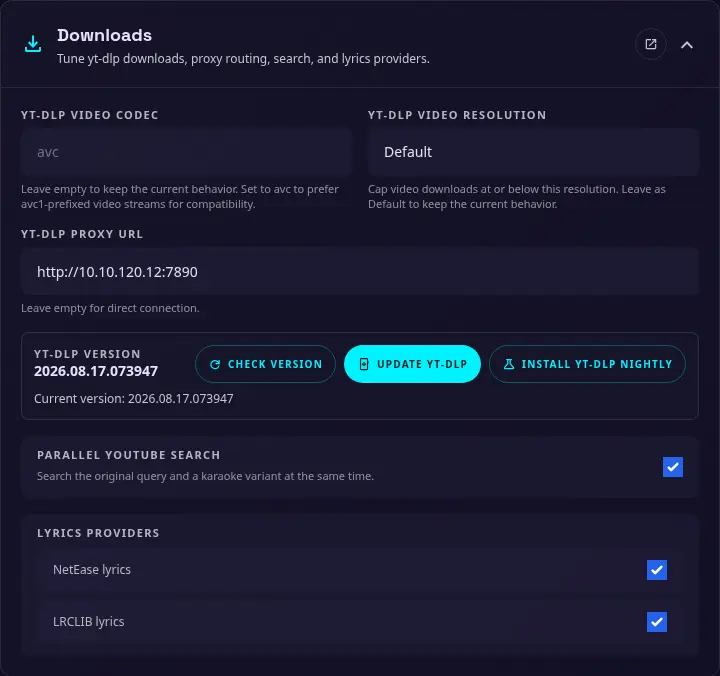

# Download {#downloads}

{ width="400" }

Usa questa sezione per configurare le preferenze di download di yt-dlp, il proxy, la ricerca parallela e i provider di testi. Puoi impostare questi valori anche tramite le [variabili d'ambiente](environments.md) se l'installazione richiede una configurazione fissa.

### Codec video yt-dlp {#yt-dlp-video-codec}

Preferenza facoltativa per il codec video usato da yt-dlp. Lascia il campo vuoto per usare la selezione predefinita di yt-dlp.

I browser sui dispositivi Apple supportano un numero limitato di codec. Se riscontri problemi di riproduzione video, imposta questo valore su `avc`.

### Risoluzione video yt-dlp {#yt-dlp-video-resolution}

Scegli `Default` per mantenere il comportamento attuale oppure seleziona `360p`, `480p`, `720p`, `1080p` o `2160p` per limitare i download video a quella risoluzione o inferiore.

### URL del proxy yt-dlp {#yt-dlp-proxy-url}

URL facoltativo di un proxy per yt-dlp e per le relative richieste in uscita. Sono supportati i proxy HTTP, HTTPS, SOCKS4 e SOCKS5. Lascia il campo vuoto per collegarti direttamente.

### Versione di yt-dlp {#yt-dlp-version}

Utilizzare **Verifica versione** per visualizzare la versione installata di yt-dlp. **Aggiorna yt-dlp** installa la versione stabile, mentre **Installa yt-dlp Nightly** installa la versione nightly. Aggiornare yt-dlp quando un provider cambia o la versione corrente non funziona più con una sorgente video.

In Docker, imposta `YTDLP_PATH=/data/tools/yt-dlp` e mantieni `/data` su uno storage persistente affinché gli aggiornamenti restino disponibili quando il container viene ricreato. Consulta le [variabili d'ambiente](environments.md#downloads-and-external-tools) per i dettagli.

### Ricerca parallela su YouTube {#parallel-youtube-search}

Esegue contemporaneamente la ricerca originale e quella per una variante karaoke. Può trovare risultati più pertinenti, ma invia più richieste.

### Provider di testi {#lyrics-providers}

Abilitare o disabilitare i provider di testi incorporati:

- **Testi NetEase**
- **Testi LRCLIB**

Disattiva un provider se non è disponibile o se non vuoi usarlo durante la ricerca dei testi.
